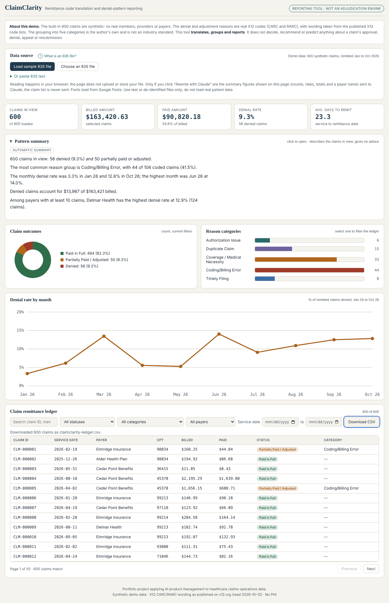

# ClaimClarity

**A plain-English view of why health-plan claims were paid, adjusted or denied.**
ClaimClarity reads a payer remittance file (EDI 835) and turns its numeric reason codes into readable explanations, a reason mix and a month-by-month denial trend. It reports on decisions already made. It does not make, question or advise on them.



> **Status:** portfolio prototype built on synthetic data. It is not validated for real claims operations. See [Known limits](#known-limits).

- **Live demo:** [apoorvab11.github.io/ClaimClarity](https://apoorvab11.github.io/ClaimClarity/) (no install or sign-in)
- **Business requirements:** [docs/BRD.md](docs/BRD.md) · **Functional requirements:** [docs/FRD.md](docs/FRD.md)
- **Independent review and what I changed:** [docs/CHANGELOG.md](docs/CHANGELOG.md)

## The problem

When a health plan pays or rejects a claim, it sends the provider a remittance file full of codes such as `CAS*CO*197*2000`. That one line means the claim was adjusted by 2,000 because a required authorization was missing, but nothing on the page says so. Analysts look codes up one at a time, group them differently from report to report, and rebuild trend views by hand. Patterns like "authorization problems are rising every month" stay buried.

## Who it is for

| User | Question they are trying to answer |
| --- | --- |
| Claims operations analyst (primary) | Why was this claim paid less than billed? |
| Claims operations manager | Are rejections rising, and for what reason? |
| Provider relations team | What evidence can I bring to a provider conversation? |
| Data or BI analyst | Can I reuse one consistent way to group reasons? |

## What it does

- Reads a standard 835 file in the browser (nothing is uploaded), or uses 600 built-in synthetic claims.
- Translates 14 verified reason and remark codes into plain English beside the official X12 wording.
- Groups every claim into one of five reason categories, plus "Other / Unmapped" so nothing is dropped.
- Shows claim count, billed and paid amounts, denial rate, average days to remit, and a denial-rate trend for every month in the data.
- Search, filter, open a claim for its code translation, and export the filtered list to CSV.
- Writes a short automatic summary. An optional Claude rewrite is checked for invented numbers and advice wording.

## What it deliberately does not do

- Decide whether a claim should be approved, denied or appealed, or advise on appeals or resubmission.
- Use real patient or payer data. The demo is synthetic; the reader is for test or de-identified files only.
- Read claim submission files (837), calculate HEDIS measures, post payments, or save anything.

The narrow scope is a product decision: my real experience is data and reporting on payer claims, not deciding claims.

## Try it

- **claude.ai:** open the shared link above. The Claude rewrite and CSV download run through the viewer's own Claude account and ask permission first.
- **Locally:** open `app/index.html` in any browser. No install needed. (The Claude rewrite is hidden; "Download CSV" saves the file directly.)
- **GitHub Pages:** in the repository settings, turn on Pages from the main branch root. `index.html` forwards to the app.

## How this was built

I led the product work: the problem, users, scope, requirements, the status and category rules, the guardrails and the test cases. I built it with Claude (an AI assistant) writing the code under that direction. I do not claim to be a software engineer. I treat the code as something I specify, review for behavior, and test.

## Evidence

| Check | Result |
| --- | --- |
| Logic tests (`tests/test_logic.js`) | 52 pass: 835 reading, status and reason rules, grouping, monthly totals, CSV safety, Claude-output guards |
| Browser tests (`tests/test_browser.js`) | 63 pass: filters (including service date), 835 help tip, CSV download, collapsible summary, keyboard use, file and paste loading, bad input, markup in a file, phone width |
| Independent recalculation | Billed, paid, denial rate, average days and status counts match a separate calculation from the raw data |
| Independent review | An external review raised 14 points; 6 reproduced and were fixed. See the [change log](docs/CHANGELOG.md) |
| Code wording | Quoted from the official X12 code lists on 2026-10-12 |

## Known limits

- The five categories and the rule that ignores routine adjustments (CO-45, PR-1, PR-2, PR-3) are my own choices, not an industry standard. They have had no domain review yet.
- Only 14 codes are translated. Other codes show as "Other / Unmapped". CARC 15 and 125 are retired on x12.org; they are kept for older files and labelled "Retired code".
- Only the first reason code on a claim is used for grouping, and only the first procedure code is shown when a claim has several service lines.
- For 835 files, the "allowed" amount is an estimate (paid plus patient share), and the page says so.
- Not yet done: testing with real de-identified 835 files, a screen reader test, a colour contrast audit, and testing with real claims analysts.
- The business case is reasoned for a hypothetical claims team. It has not been validated with real users.

## Roadmap

1. Domain review of the category rules and a documented, versioned code mapping.
2. Test with two or three real de-identified 835 files.
3. Show every service line of a claim.
4. Screen reader test and contrast audit.
5. Interview two or three claims analysts and replace target measures with measured ones.

## Repository layout

```
app/index.html          the single-file page (built output)
src/template.html       page source
src/pure.js             logic extracted for tests (built output)
data/                   synthetic claims and a sample 835
scripts/generate_data.py  reproducible synthetic data (fixed seed)
scripts/build.py        builds app/index.html and src/pure.js
tests/                  logic and browser tests, plus a synthetic test fixture
docs/                   BRD, FRD, metric definitions, change log, decisions
```

To rebuild and test: `python3 scripts/build.py`, then `npm test` (needs Node and Playwright for the browser tests).

## Data and notices

All demo claims are synthetic: no real members, providers or payers. Reason and remark code wording is quoted from the X12 code lists for reference; X12 owns those lists. CPT is a trademark of the AMA, so the page shows short service labels written by me, not CPT descriptions.

Licensed under the MIT License (see `LICENSE`).
